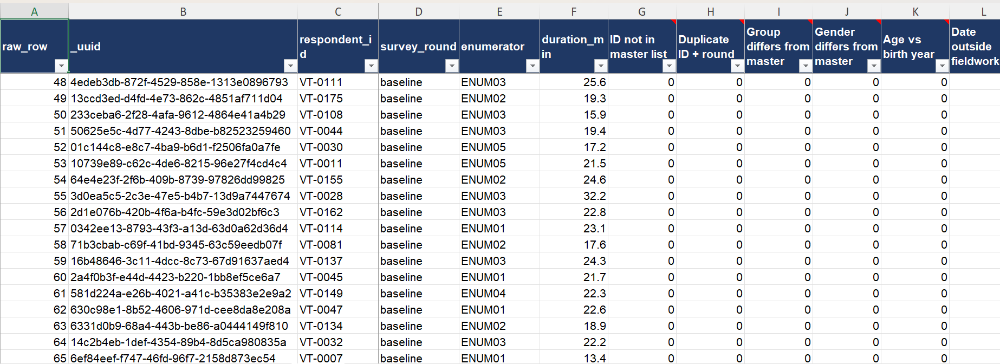
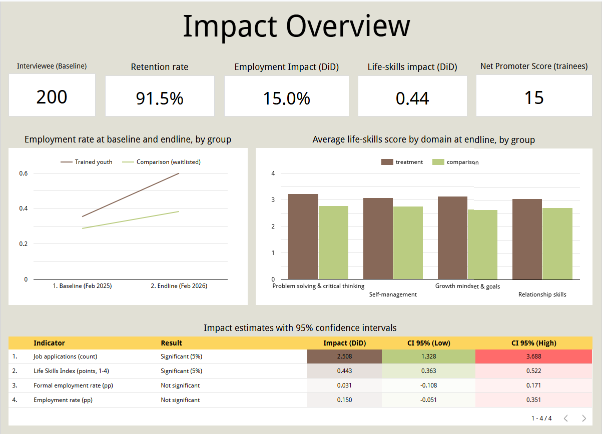

# Social Impact Evaluation: Youth Vocational Training Program

End-to-end impact evaluation in four parts: survey design in **KoboToolbox (XLSForm)**, data cleaning and validation in **Excel**, impact analysis in **SQL (BigQuery)**, and an interactive **Looker Data Studio** dashboard, summarised in a short findings report.

In this project, I designed a short baseline and endline survey, built an Excel template that checks every submission and logs every cleaning decision, then analysed the clean data to answer whether a vocational training program improved young people's life skills, job search and employment, who benefited most, and how participants rated the training.

> **Business context:** I approached this as the MEL (Monitoring, Evaluation and Learning) analyst for an NGO running a youth vocational training program in East Java, Indonesia. The program team and its donors want to know whether the training works, for whom, and what to improve before the next cohort. A plain before/after comparison could not answer that, because the job market also changed over the year, so the evaluation compares trained youth with a waitlisted comparison group.

> **Note on the data:** all data is **synthetic**. I generated a realistic panel of 200 youth (120 trained, 80 waitlisted) interviewed twice, and deliberately planted the errors a real field team makes (test entries, duplicates, mistyped IDs, a wrong tablet date, income typos, rushed interviews) so the cleaning step has real work to do. The numbers demonstrate the method; they are not results of a real program.

**Tools:** KoboToolbox (XLSForm) · Excel (formula-based checks, data validation, conditional formatting) · BigQuery SQL · Looker Data Studio

**Survey (XLSForm | pdf | Kobo preview):** [Click Here](./01_VTP_Impact_Survey_XLSForm.xlsx) | [Click Here](./VTP_Questionnaire.pdf) | [Click Here](https://ee.kobotoolbox.org/preview/nKm6APNT)

**SQL Query:** [Click Here](./VTP_SQL_queries.sql)

**Data Cleaning Template (Excel):** [Click Here](./02_VTP_Data_Cleaning_Template.xlsx)

**Looker Data Studio Dashboard:** [Click Here](https://datastudio.google.com/reporting/2a117445-3711-4fa5-bf32-c86fd1e6af35)

**Summary Report (PDF):** [Click Here](./VTP_Impact_Evaluation_Summary_Report.pdf)

---

## Contents

- [Social Impact Evaluation: Youth Vocational Training Program](#social-impact-evaluation-youth-vocational-training-program)
  - [Contents](#contents)
  - [Business questions](#business-questions)
  - [Executive summary](#executive-summary)
  - [Dataset](#dataset)
  - [Survey design](#survey-design)
  - [Data cleaning and validation](#data-cleaning-and-validation)
    - [The cleaning template](#the-cleaning-template)
    - [Issues found and how they were handled](#issues-found-and-how-they-were-handled)
  - [Key definitions](#key-definitions)
  - [Methodology](#methodology)
  - [Findings](#findings)
    - [1. Sample and attrition](#1-sample-and-attrition)
    - [2. Were the groups comparable before training?](#2-were-the-groups-comparable-before-training)
    - [3. Life skills](#3-life-skills)
    - [4. Job search](#4-job-search)
    - [5. Employment, job quality and income](#5-employment-job-quality-and-income)
    - [6. Who benefits most](#6-who-benefits-most)
    - [7. Participant feedback](#7-participant-feedback)
    - [8. Is the sample large enough?](#8-is-the-sample-large-enough)
  - [Looker Data Studio dashboard](#looker-data-studio-dashboard)
  - [Recommendations](#recommendations)
  - [Limitations](#limitations)
  - [Repository structure](#repository-structure)

---

## Business questions

1. **Sample:** How many youth did we interview in each round, and how many did we lose by endline?
2. **Comparability:** Were trained and waitlisted youth similar before the training?
3. **Life skills:** Did the training improve life skills, and which skills improved most?
4. **Job search:** Did trained youth look for work more actively, and more successfully?
5. **Employment:** Did more trained youth find work, in better jobs, earning more?
6. **Equity:** Did women and men benefit equally, and which training tracks worked best?
7. **Participant feedback:** Did participants value the training, and which tracks need improvement?
8. **Evidence strength:** Is the sample large enough to detect the effects we care about?

---

## Executive summary

| Area | Headline |
|---|---|
| **Sample** | 200 youth at baseline, **183 re-interviewed at endline (91.5%)**, with almost identical retention in both groups (91.7% vs 91.2%). |
| **Comparability** | Groups were **similar before training**: 49% vs 48% female, average age 22.1 vs 22.3, employment 32.5% vs 28.7%. |
| **Life skills** | Trained youth gained **0.44 points more** than the comparison group on a 1–4 scale (95% CI 0.36 to 0.52). **98% of trained youth improved**, against 60% of the comparison group. |
| **Job search** | **+2.5 more job applications** a year than the comparison group, and **twice as many offers per application** (15.7% vs 7.9%). |
| **Employment** | Employment rose **24.5 points** for trained youth and 9.6 points for the comparison group. The **15-point difference is not statistically significant** (95% CI −5 to +35 points). |
| **Job quality** | **No gain in formal jobs** (+3.1 points, not significant). Among employed youth, 41% of trained youth held formal jobs vs 46% in the comparison group. |
| **Equity** | Women and men gained **equally** in life skills (+0.53 vs +0.57 points). |
| **Training tracks** | **Garment & Tailoring** had the largest employment gain (15% → 55%) but the **lowest relevance and satisfaction** and a negative NPS. |
| **Feedback** | **78% satisfied**, 82% used the skills, Net Promoter Score **+15**. |
| **Data quality** | 15 automated checks flagged 55 of 391 submissions; **every flag has a logged decision**, and 8 submissions were removed. |
| **Evidence strength** | With 183 youth, only an employment effect of **about 29 points** would reliably show as significant; confirming a 15-point effect needs **about 675 youth**. |

**Top priorities:** keep the life-skills curriculum, strengthen the step from job search to job placement, add job-quality support, review the Garment & Tailoring and Hospitality tracks with employers, and plan a larger follow-up to confirm the employment effect.

---

## Dataset

| | Detail |
|---|---|
| **Design** | Baseline (Feb 2025) and endline (Feb 2026) survey, treatment vs comparison group |
| **Groups** | 120 youth who completed training (treatment), 80 waitlisted applicants (comparison) |
| **Location** | Surabaya, Sidoarjo, Gresik, Malang and Mojokerto, East Java, Indonesia |
| **Training tracks** | Automotive, Barista & F&B, Digital Marketing, Garment & Tailoring, Hospitality |
| **Raw data** | KoboToolbox export: **391 submissions, 52 columns** |
| **Master list** | Program records for 200 respondents (group, track, cohort, gender, birth year, city) |
| **Clean data** | **383 interviews, 63 columns** (200 baseline, 183 endline), one row per respondent per round |
| **Tools** | KoboToolbox, Excel, BigQuery SQL, Looker Data Studio |

---

## Survey design

📋 [VTP_Impact_Survey_XLSForm.xlsx](./01_VTP_Impact_Survey_XLSForm.xlsx)

I shortened the program's original tracer survey (about 200 fields, in Indonesian) to **39 questions in English**, about 20 minutes per interview, ready to upload to KoboToolbox.

| Section | Questions | Content |
|---|---|---|
| A. Interview details | 6 | Enumerator, date, survey round, respondent ID, group, consent |
| B. Respondent profile | 5 | Gender, age, city, education, disability |
| C. Life skills | 12 | 4-point agreement scale in 4 domains (3 items each), 2 reverse-worded items |
| D. Work and job search | 8 | Employment (ILO 7-day definition), job type, contract, hours, income, applications, interviews, offers |
| E. Further learning | 3 | Other courses or training in the past 12 months |
| F. Training feedback | 4 | Satisfaction, relevance, skills used, likelihood to recommend (NPS). Trained youth at endline only |
| G. Closing | 1 | Consent to follow-up |

**Built-in checks:** respondent ID format (`regex(., '^VT-[0-9]{4}$')`), age 15–35, hours 0–84, interviews and offers can't exceed applications, dates can't be in the future, and skip logic so each person only sees questions that apply to them. A "no" to consent ends the interview.

---

## Data cleaning and validation

📊 [VTP_Data_Cleaning_Template.xlsx](./02_VTP_Data_Cleaning_Template.xlsx)

### The cleaning template

The template turns a raw KoboToolbox export into an analysis-ready dataset, with every change documented. It is reusable: thresholds and reference lists live in one sheet, and the checks are live formulas for up to 600 submissions.

| Sheet | Purpose |
|---|---|
| **README** | 7-step workflow, sheet guide, colour key and data-protection note |
| **Summary** | Cleaning KPIs, flags by check, decisions by action, enumerator quality table, and a first DiD table (AVERAGEIFS) |
| **Parameters** | All thresholds (age, interview length, income range, fieldwork dates) and reference lists (cities, enumerators) |
| **Raw_Data** | The untouched KoboToolbox export (391 × 52) |
| **Master_List** | Program records: the source of truth for group, gender, birth year and track |
| **Checks** | 15 formula-based 0/1 flags per submission, with a status: OK, To review, or Logged once a decision is recorded |
| **Cleaning_Log** | Audit trail: original value, new value, action, justification and how it was verified (59 entries) |
| **Clean_Data** | Analysis-ready panel with formula-derived columns: reverse-coded items, domain scores, Life Skills Index, indicator flags (383 × 63) |
| **Data_Dictionary** | Every clean variable: question, type, allowed values, source and derivation |

Techniques used: COUNTIF / COUNTIFS for duplicates and ID checks, INDEX / MATCH lookups against the master list, SUMPRODUCT(EXACT()) for case- and space-sensitive matching, DATEVALUE + TIMEVALUE for interview length from Kobo timestamps, data validation drop-downs and conditional formatting.

### Issues found and how they were handled

The 15 checks flagged **55 of 391 submissions**. Every flag was reviewed and logged, including false positives.

| Issue | Records | Action |
|---|---|---|
| City typed in different ways (`surabaya`, `SBY`, `Kab. Sidoarjo`, `MALANG`) | 17 | Standardised to the official name |
| Duplicate ID + round (tablet re-sent the same interview) | 4 copies | Deleted the copy; the original was kept (5 "No change" decisions logged for the originals and the genuine record sharing a mistyped ID) |
| Respondent ID mistyped (`VT-0215` for `VT-0125`, digits swapped) | 3 | Corrected using the master list and an enumerator call-back |
| Wrong group selected by the enumerator | 2 | Corrected to the master list; training feedback from a comparison respondent set to blank (4 values) |
| Income outside the review range (extra zero, amount typed in thousands) | 4 | 3 corrected after call-back; 1 genuine high earner (a coffee-shop owner) kept and flagged |
| Gender differs from baseline and master list | 2 | Corrected (tap error) |
| Age doesn't fit birth year (e.g. 28 typed for 18) | 2 | Corrected from the master list |
| Tablet clock reset to 2024-01-01 | 2 | Interview date taken from the Kobo server timestamp |
| Employed but 0 hours a week | 2 | 1 corrected after call-back; 1 on sick leave set to blank |
| "Other" answers that fit an existing category (Coursera course, government sewing course) | 3 | Recoded |
| Same answer on all 12 life-skills items, including reverse-worded ones | 3 | Kept, but excluded from life-skills scores |
| Interview under 8 minutes | 2 | 1 confirmed by a supervisor back-check (kept); 1 never took place (deleted, counted as attrition) |
| Interview over 120 minutes (form left open) | 1 | Kept; duration not used |
| Test submissions during enumerator training | 2 | Deleted |
| Consent refused at endline | 1 | Removed, counted as attrition |

**Result:** 391 submissions → **383 clean interviews**. 8 removed (2 test, 4 duplicates, 1 refusal, 1 fabricated interview), 36 records corrected, 0 issues pending.


---

## Key definitions

| Term | Meaning |
|---|---|
| **Treatment / comparison** | Youth who completed the training / eligible applicants who were waitlisted. |
| **Panel** | Youth interviewed in both rounds (`in_panel = 1`), used for all before/after comparisons. |
| **Difference-in-differences (DiD)** | Change among trained youth minus change in the comparison group. It removes changes that affect everyone, such as the job market. |
| **Life Skills Index** | Average of the 12 life-skills items on a 1–4 scale, after reverse-coding the 2 negatively worded items (5 − answer). Each of the 4 domains is the average of its 3 items. |
| **Employed** | Did paid work or ran a business for at least 1 hour in the past 7 days, including those temporarily absent from a job (ILO definition). |
| **Formal employment** | Employee of a registered employer. Counted as 0 for everyone else, including those not working. |
| **pp** | Percentage points: the difference between two percentages. |
| **95% confidence interval (CI)** | The range the true effect is likely to fall in. If it doesn't include 0, the effect is significant at 5%. |
| **Net Promoter Score (NPS)** | % promoters (rated 9–10) − % detractors (0–6), from −100 to +100. |
| **Minimum detectable effect (MDE)** | The smallest effect the sample can reliably detect: 2.8 × standard error (5% significance, 80% power). |

---

## Methodology

- **Difference-in-differences on the panel:** each youth's change between rounds is compared across groups, so trends that affect everyone don't count as impact.
- **Significance:** a two-sample t-test (Welch) on change scores, with standard errors, 95% confidence intervals and t-statistics calculated in SQL. An effect is significant when |t| > 1.96, i.e. the CI excludes 0.
- **Baseline balance check** before trusting the comparison.
- **Medians for income**, because income is skewed by a few high earners.
- **Small groups flagged:** results by training track (12–29 youth each) are descriptive only.
- **Power check:** minimum detectable effect and the sample needed to confirm the observed effects.
- **Dashboard-ready outputs:** three BigQuery views (`vw_dashboard`, `vw_respondent_change`, `vw_lifeskills_long`) and saved summary tables (`q4_impact`, `q5_domains`, `q7_funnel`) feed the Looker Data Studio dashboard.

Significance level: p < 0.05.

---

## Findings

### 1. Sample and attrition

*SQL Q1*

| Group | Baseline | Endline | Lost | Retention |
|---|---|---|---|---|
| Treatment | 120 | 110 | 10 | 91.7% |
| Comparison | 80 | 73 | 7 | 91.2% |

- **Attrition was low and almost equal in both groups** (8.3% vs 8.8%), so it is unlikely to bias the comparison.
- Of the 17 youth lost, 15 couldn't be found, 1 refused and 1 interview was removed after a failed back-check.

### 2. Were the groups comparable before training?

*SQL Q2, baseline*

| Characteristic | Treatment | Comparison |
|---|---|---|
| Female | 49.2% | 47.5% |
| Average age | 22.1 | 22.3 |
| Vocational high school graduate | 35.8% | 33.8% |
| Employed | 32.5% | 28.7% |
| Life Skills Index (1–4) | 2.57 | 2.63 |
| Job applications, past 12 months | 5.1 | 5.8 |

- **The groups started in a similar place.** Trained youth were slightly more often employed and slightly less active in job search, but no gap is large.
- **DiD handles the remaining gaps:** it compares how much each group *changed*, not where they ended up.

### 3. Life skills

*SQL Q4, Q5, Q11*

| Domain | Treatment baseline → endline | Comparison baseline → endline | Impact (DiD) |
|---|---|---|---|
| Problem solving & critical thinking | 2.61 → 3.22 | 2.73 → 2.77 | **+0.57** |
| Growth mindset & goals | 2.56 → 3.13 | 2.55 → 2.63 | +0.49 |
| Self-management | 2.54 → 3.07 | 2.61 → 2.76 | +0.39 |
| Relationship skills | 2.58 → 3.05 | 2.56 → 2.72 | +0.32 |

- **The Life Skills Index rose 0.55 points for trained youth and 0.11 for the comparison group: an impact of +0.44** (95% CI 0.36 to 0.52, t = 10.9). This is the clearest effect in the evaluation.
- **Almost every trained youth improved:** 108 of 110 (98.2%), against 42 of 70 (60.0%) in the comparison group, where 20 declined.
- **Problem solving improved most**, and every domain improved more for trained youth.

### 4. Job search

*SQL Q3, Q4, Q7*

*Job search in the past 12 months, endline*

| Group | Applications | Interviews | Offers | Interviews per application | Offers per application |
|---|---|---|---|---|---|
| Treatment (110) | 841 | 297 | 132 | 35.3% | **15.7%** |
| Comparison (73) | 444 | 101 | 35 | 22.7% | 7.9% |

- **Trained youth applied more:** applications per person rose from 4.95 to 7.65, against 5.89 to 6.08 in the comparison group, an impact of **+2.5 applications a year** (95% CI 1.3 to 3.7).
- **They also applied better:** twice as many offers per application. This points to stronger CVs, interviews or targeting, not just more effort.
- **More trained youth kept learning:** 36.4% took another course at endline, up from 16.4%, against 9.6% → 17.8% in the comparison group.

### 5. Employment, job quality and income

*SQL Q3, Q4, Q6 and dashboard page 2*

| Indicator | Treatment | Comparison | Impact (DiD) | 95% CI | Significant? |
|---|---|---|---|---|---|
| Employment rate | 35.5% → 60.0% | 28.8% → 38.4% | +15.0 pp | −5.1 to +35.1 pp | No |
| Formal employment rate | 11.8% → 24.5% | 8.2% → 17.8% | +3.1 pp | −10.8 to +17.1 pp | No |

- **More trained youth found work, but the gain isn't proven yet.** 43 of 110 trained youth (39%) found work between rounds, against 20 of 73 (27%) in the comparison group. The 15-point difference is encouraging, but its confidence interval includes zero (t = 1.46).
- **Jobs were not better quality.** Among employed youth at endline, 40.9% of trained youth held formal jobs vs 46.4% in the comparison group, and the formal employment impact is close to zero.
- **Some jobs didn't last:** 16 trained youth (15%) lost a job they had held at baseline.

*Median monthly income of employed panel youth (IDR)*

| Group | Baseline | Endline |
|---|---|---|
| Treatment | 2,650,000 (39 employed) | 3,400,000 (66 employed) |
| Comparison | 2,800,000 (21 employed) | 3,250,000 (28 employed) |

- **Median income rose more for trained youth** (+750K vs +450K), but this is descriptive only: the group of employed youth changes between rounds, so the difference can't be credited to the training.

### 6. Who benefits most

*SQL Q8, Q9 and dashboard page 3*

| Gender | Employment DiD | Life skills: treatment change | Life skills: comparison change |
|---|---|---|---|
| Female | +12.5 pp | +0.53 | +0.06 |
| Male | +17.0 pp | +0.57 | +0.15 |

- **Women and men gained equally in life skills.** The employment gain was slightly larger for men, but neither is significant at this sample size.

*Trained youth by track (panel)*

| Track | Youth | Employment baseline → endline | Change | Life-skills change |
|---|---|---|---|---|
| Garment & Tailoring | 20 | 15.0% → 55.0% | **+40.0 pp** | +0.62 |
| Automotive | 12 | 50.0% → 83.3% | +33.3 pp | +0.63 |
| Digital Marketing | 29 | 37.9% → 62.1% | +24.1 pp | +0.54 |
| Barista & F&B | 21 | 33.3% → 57.1% | +23.8 pp | +0.50 |
| Hospitality | 28 | 42.9% → 53.6% | **+10.7 pp** | +0.51 |

- **Every track gained a similar amount in life skills** (+0.50 to +0.63).
- **Employment gains varied widely:** Garment & Tailoring gained most, Hospitality least. Groups are small (12–29), so these differences are indicative only.

### 7. Participant feedback

*SQL Q10, Q12, trained youth at endline (110)*

| Track | Satisfied (4–5 of 5) | Relevance (1–5) | Used the skills | NPS |
|---|---|---|---|---|
| Automotive | 83.3% | 3.92 | 83.3% | **+50.0** |
| Barista & F&B | 71.4% | 4.29 | 81.0% | +28.6 |
| Digital Marketing | 86.2% | 4.28 | 69.0% | +20.7 |
| Hospitality | 82.1% | 4.07 | 89.3% | −3.6 |
| Garment & Tailoring | 65.0% | **3.45** | 90.0% | **−5.0** |
| **All tracks** | **78.2%** | **4.04** | **81.8%** | **+14.5** |

- **Participants rated the training well overall:** 78% satisfied and 82% used the skills at work or in job search.
- **NPS is +15:** 42 promoters, 42 passives and 26 detractors (Q12).
- **Garment & Tailoring is a paradox:** the largest employment gain, but the lowest satisfaction and relevance. Graduates found work, but not necessarily using what they were taught.
- **Hospitality** has a negative NPS and the smallest employment gain.

### 8. Is the sample large enough?

*SQL Q13*

| Indicator | Observed impact | Minimum detectable effect | Above MDE? | Youth needed to confirm the observed impact |
|---|---|---|---|---|
| Life Skills Index | +0.44 | 0.11 | Yes | 12 |
| Job applications | +2.5 | 1.7 | Yes | 83 |
| Employment rate | +15.0 pp | 28.7 pp | No | **675** |
| Formal employment rate | +3.1 pp | 20.0 pp | No | 7,400 |

- **The life-skills and job-search results are robust:** they are far above what this sample can detect.
- **The employment result is underpowered, not negative.** A 15-point effect would need about **675 youth in both rounds**, roughly 3.7 times this sample, or a longer follow-up.
- **The formal-employment effect is too small to matter in practice:** confirming it would take 7,400 youth.

---

## Looker Data Studio dashboard

📊 [Open the dashboard](https://datastudio.google.com/reporting/2a117445-3711-4fa5-bf32-c86fd1e6af35)

The dashboard is built on three BigQuery views and three saved summary tables, with track, gender, city and cohort filters.

| Page | Question it answers | Main visuals |
|---|---|---|
| **1. Impact Overview** | Did the training work? | KPI scorecards (youth surveyed, retention, employment DiD, life-skills DiD, NPS), employment before vs after, life skills by domain, impact estimates with 95% CI |
| **2. Employment & Income** | What happened to each young person's work and earnings? | Employment transitions, type of work, median income, job search funnel, employment by track |
| **3. Life Skills** | Which skills improved, and for whom? | Average gain by group, domain scores before and after, impact by domain, gains by gender, baseline vs endline scatter |
| **4. Participant Feedback** | Did participants value the training? | NPS, satisfaction and skills-used scorecards, NPS by track, satisfaction ratings, relevance vs satisfaction by track |



---

## Recommendations

1. **Keep and scale the life-skills curriculum.** It has the clearest and largest effect, especially on problem solving and goal setting. Protect these modules in any redesign or budget cut.
2. **Strengthen the link from job search to jobs.** Trained youth apply more and convert better, but the employment gain is not yet proven. Add employer partnerships, job matching and interview preparation in the final weeks of training, and support graduates in their first months of work, since 15% lost a job they had held at baseline.
3. **Focus on job quality, not only placement.** Trained youth were no more likely to be in formal jobs. Add contract-readiness content (workers' rights, written contracts, social security registration) and target formal employers for placements.
4. **Review the Garment & Tailoring and Hospitality tracks with industry input.** Both have negative NPS, and Garment & Tailoring has the lowest relevance rating despite the largest employment gain. Update the content to match employer needs, then re-check satisfaction with the next cohort.
5. **Improve the next round of monitoring and evaluation.**
   - *Sample:* about 675 youth in both rounds, or a longer follow-up, to confirm an employment effect of around 15 points.
   - *Survey:* replace the free-text city question with a drop-down list (city spellings were the most common fix, 17 of 59 log entries).
   - *Field team:* refresher training for the enumerator with the highest issue rate (21.3 issues per 100 interviews, against 11.5–14.4 for the others).

---

## Limitations

- **Synthetic data:** results demonstrate the method and are not findings about a real program.
- **Not randomised:** the comparison group is waitlisted applicants. The groups were similar at baseline, but unmeasured differences, such as motivation, may remain.
- **Sample size:** 183 panel youth limit the power to detect employment effects; track-level results rest on 12–29 youth each.
- **Self-reported data:** income, hours and life-skills answers may contain recall or social-desirability bias.
- **Short follow-up:** 12 months may be too soon to see the full effect on employment and job quality.
- **Approximate medians:** BigQuery's `APPROX_QUANTILES` and Data Studio's median are approximate, so median income can differ slightly from the exact value (e.g. 3.2–3.3M for the comparison group at endline).

---

## Repository structure

```
Social-Impact-Analysis/
├── README.md
├── VTP_Impact_Survey_XLSForm.xlsx
├── VTP_Questionnaire.xlsx
├── VTP_Data_Cleaning_Template.xlsx
├── VTP_SQL_queries.sql
├── VTP_Impact_Evaluation_Summary_Report.pdf
├── data/
│   ├── vtp_clean_data.csv
│   └── vtp_cleaning_log.csv
└── images/
    ├── dashboard_page1.png
    └── vtp_*.png
```

---

*Author: Jocelin · [LinkedIn](https://www.linkedin.com/in/jocelin-helsa-418092264/) · [Email](mailto:celinhelsa28@gmail.com)*
